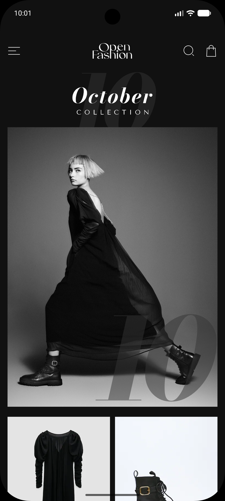
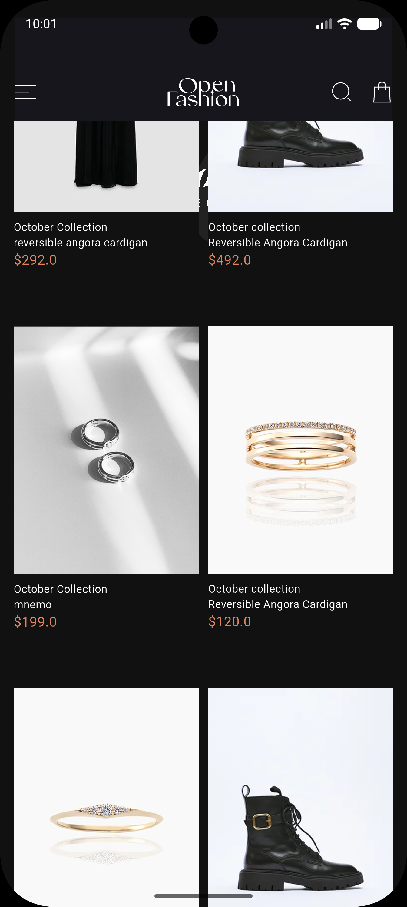
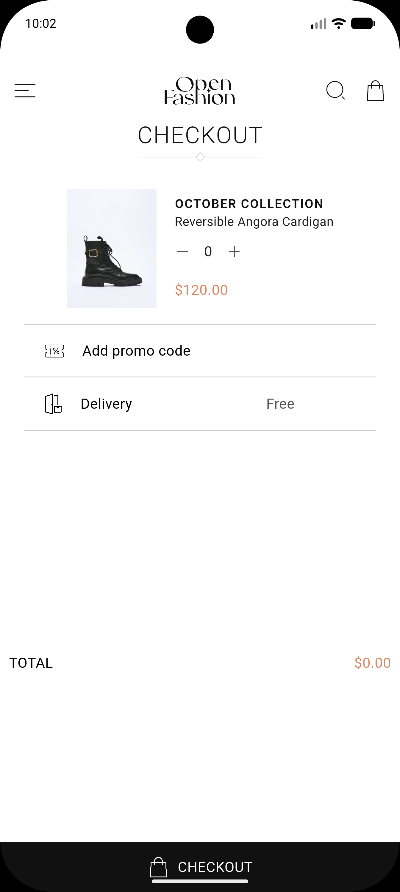
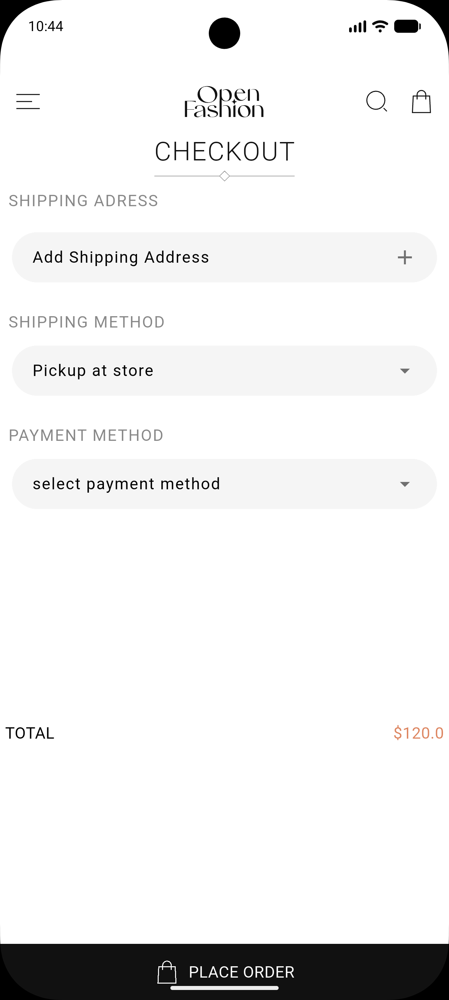
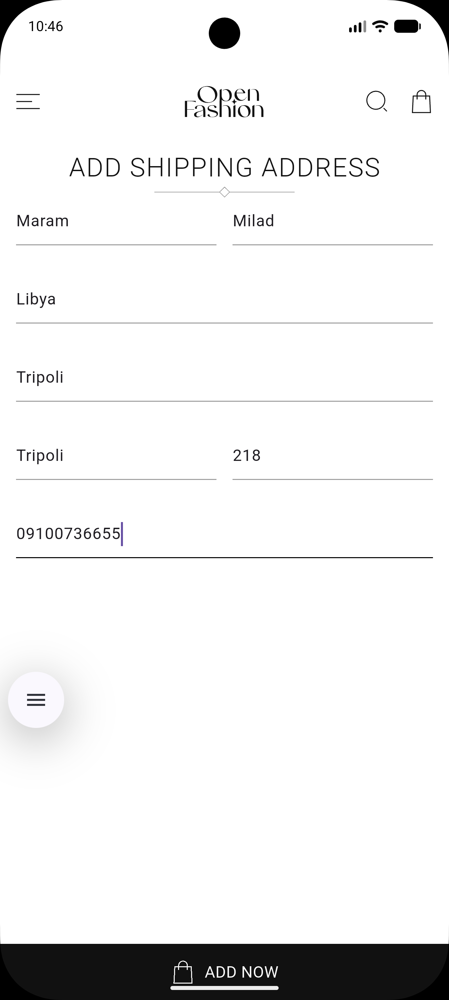
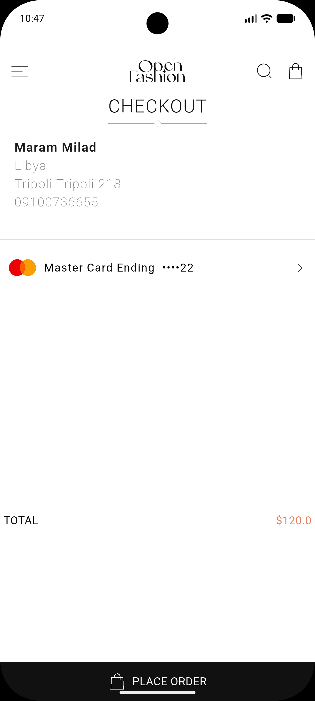
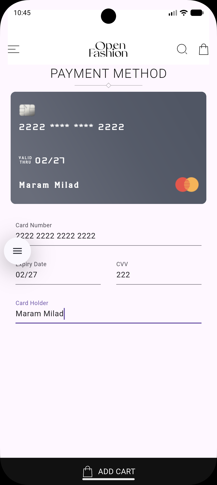
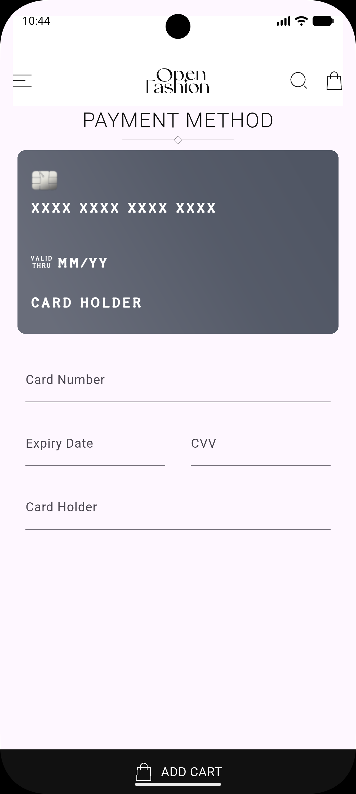
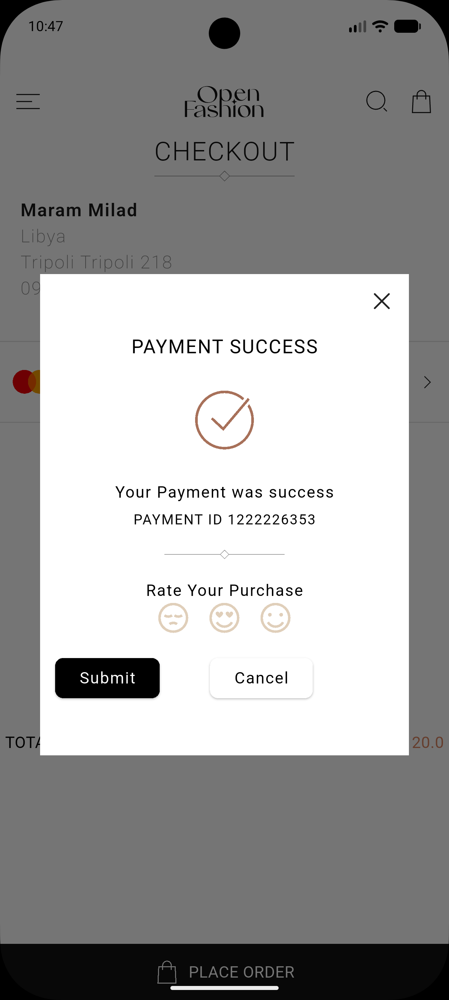

# 👗 Open Fashion - E-Commerce UI

<div align="center">


**A pixel-perfect Flutter implementation of a modern fashion e-commerce UI.** ✨

</div>

---

## 📱 About The Project

**Open Fashion** is a meticulously crafted mobile UI for a premium clothing store. The project focuses on delivering a seamless, elegant, and highly responsive user experience. Every screen has been designed and developed to match modern e-commerce standards.

This project showcases advanced UI implementation in Flutter, including smooth animations, custom widgets, and a clean layout structure.

---

## 🎨 UI Showcase (What I Built)

Here is a visual walkthrough of the screens implemented in this project:

<div align="center">

### 1. Collection & Product Details
*Elegant product displays with smooth scrolling and high-quality imagery.*




<br/><br/>

### 2. Checkout & Address Management
*Clean forms, shipping options, and a seamless checkout flow.*






<br/><br/>

### 3. Payment Method & Success
*Interactive credit card UI and a beautiful payment success screen.*





</div>

---

## ✨ UI Features

- 🎨 **Pixel-Perfect Design** - Translated directly from Figma to Flutter.
- ⚡ **Smooth Animations** - Seamless transitions between screens.
- 🧩 **Reusable Components** - Modular and clean widget structure.
- 🌙 **Modern Aesthetics** - Minimalist typography and elegant color palette.

---

## 🛠️ Tech Stack

| Technology | Purpose |
|------------|---------|
| **Flutter** | UI Framework |
| **Dart** | Programming Language |
| **Figma** | UI/UX Design & Prototyping |
| **flutter_gap** | Clean and easy spacing |
| **flutter_icons_pro** | High-quality icons |

---

## 🚀 How to Run

Want to see it in action? Follow these steps:

1. **Clone the repository:**
   ```bash
   git clone https://github.com/maramrmilad7/Fashoin-Store.git
## Figma link
[figma_fashoin_store_design](https://www.figma.com/design/CGQpIVfb1nrXbZys9Iwus6/Open-Fashion---Free-eCommerce-UI-Kit--Community-?node-id=417-615&p=f&t=AAUAg2JTH758WFwB-0)
